<div align="center">

# QueueFlow

**Token queues for busy clinic front desks.**
Add a patient, call the next one to a counter, and let everyone see where they stand: on the waiting-room TV and on their own phone.

[](https://github.com/TechWithAkash/QueueFlow/actions/workflows/ci.yml)


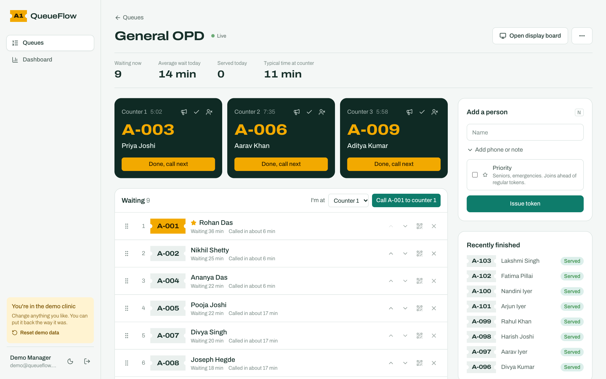

</div>

---

## In plain words

Think of the paper token roll at a bank or a clinic. Someone hands out numbers, shouts them, loses track of who came first, and nobody knows how long the wait really is.

QueueFlow replaces that with one small website:

1. **The front desk** types a patient's name. The patient gets a token like `A-005`.
2. **The doctor's counters** press "Call next". The system picks the right person, always in the right order, even if two counters press at the same instant.
3. **The waiting room** sees a big TV board with who is being served and who is up next. It plays a chime and reads the token aloud.
4. **Patients** scan a QR code and follow their place in line on their own phone. No app to install, and no need to stand near the desk.
5. **The manager** opens a dashboard that shows how long people wait, when the clinic is busiest, and what to change.

Every screen updates by itself within about a second.

## Screens

| Manager console | Waiting-room board |
| :---: | :---: |
|  | 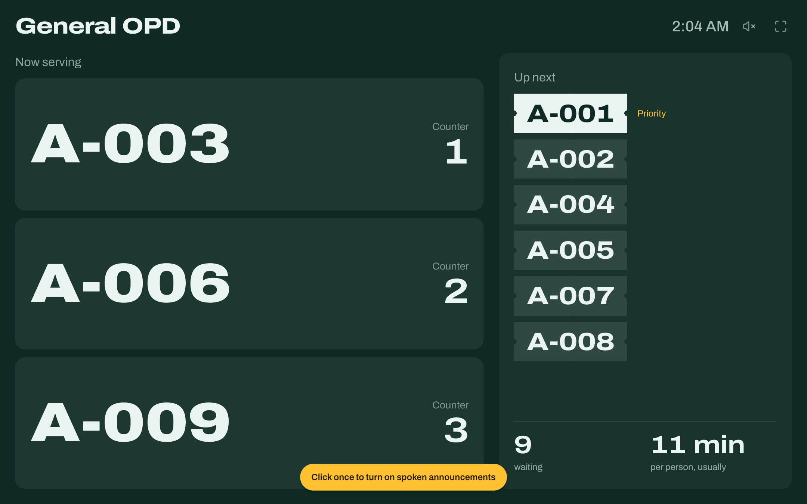 |
| Add people, reorder, call, cancel (with undo) | Full-screen board with chime and spoken call-outs |

| Analytics dashboard | Patient tracker (phone) |
| :---: | :---: |
| 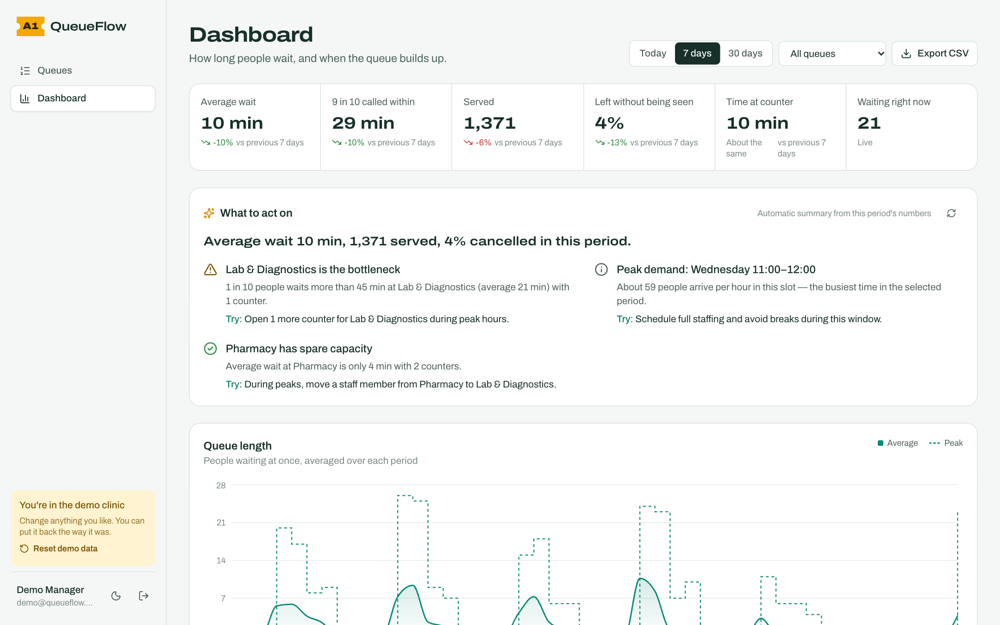 | 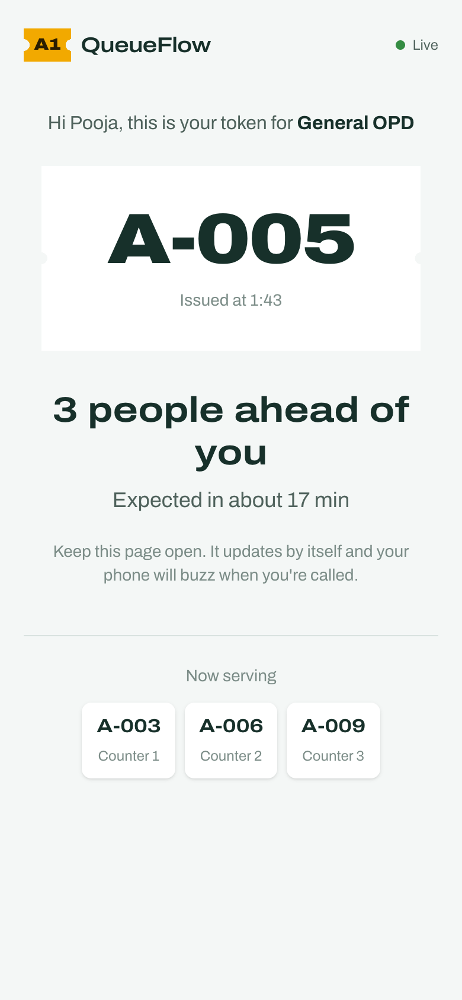 |
| Wait times, queue length trends, busiest hours | People ahead and estimated wait, updating live |

<details>
<summary><b>See the full dashboard</b></summary>
<br />
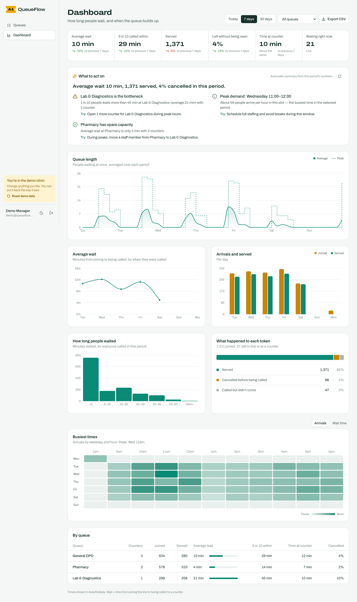
</details>

<details>
<summary><b>See the landing page and QR dialog</b></summary>
<br />
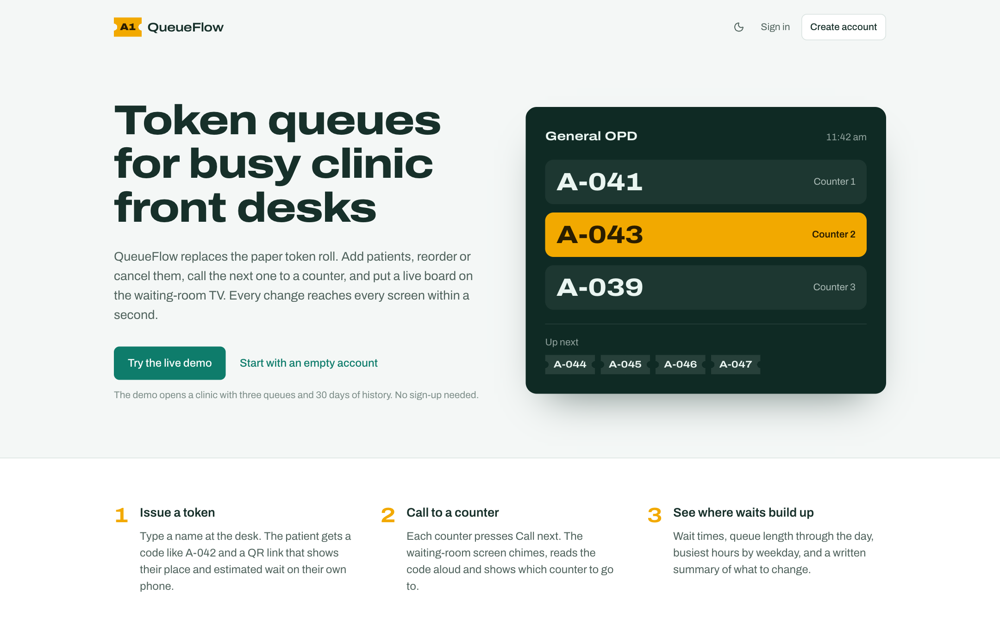
<br /><br />
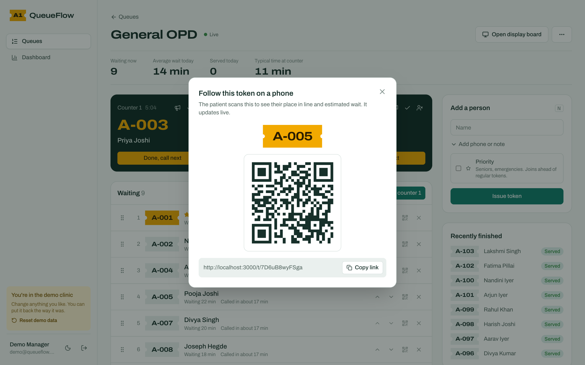
</details>

## How the app works

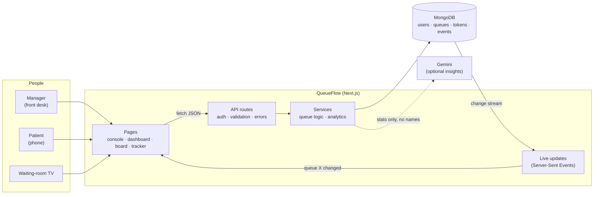

### What happens to a token

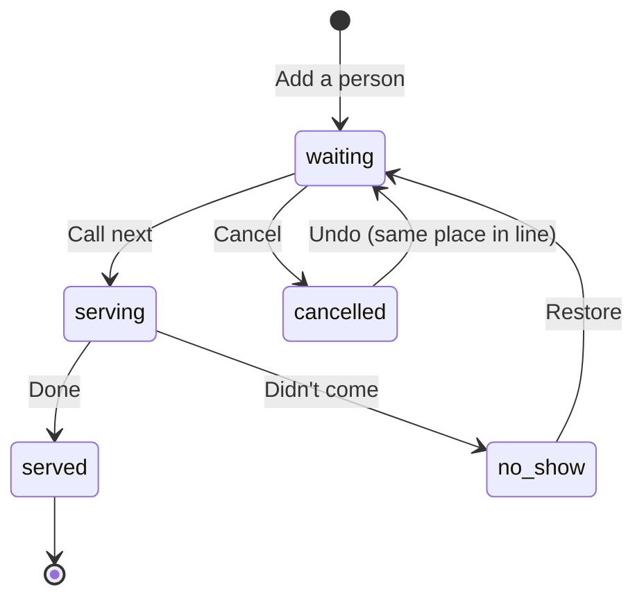

### What happens when a counter presses "Call next"

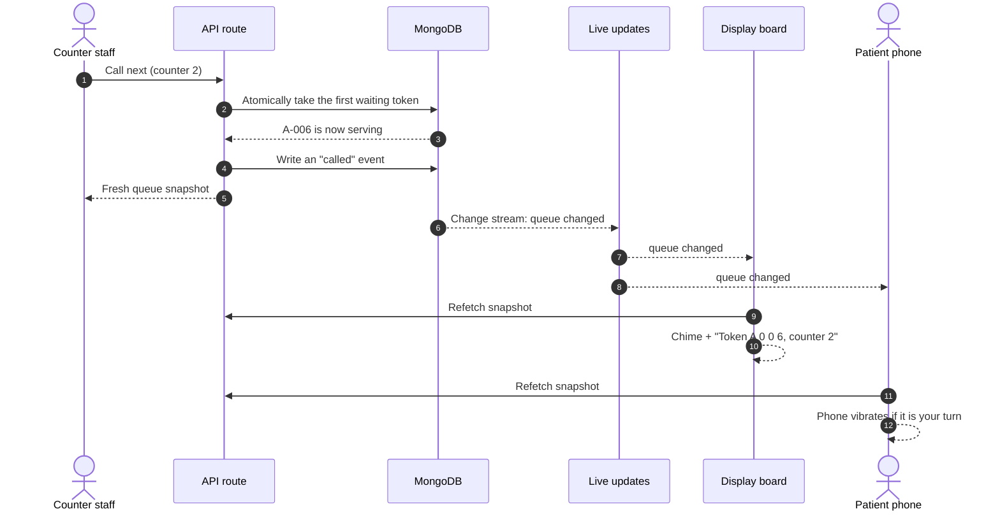

### Data model

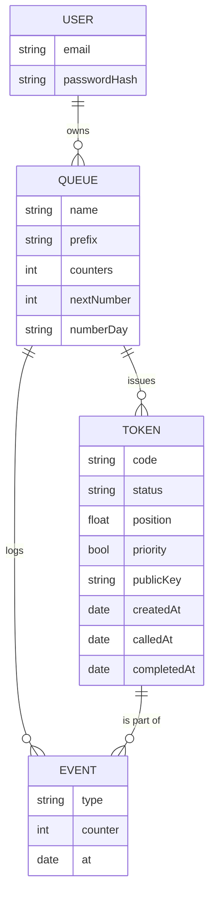

## Features

### What the assignment asked for

| Requirement | How QueueFlow does it |
| --- | --- |
| Manager logs in | Email and password accounts (bcrypt + signed HTTP-only cookie), plus one-click demo login |
| Create queues with a name | Queues page: name, token prefix (A, L, P…) and number of counters |
| Add a person, get a token | Console sidebar: name, optional phone or note, priority. Issues `A-001`, `A-002`… and restarts every day |
| List of waiting tokens | Live list on the console, in sync across every open screen |
| Move tokens up and down | Arrow buttons, keyboard, or drag and drop |
| Assign the top token for service | "Call next" per counter. Two counters never get the same token |
| Cancel a token | Cancel with an **Undo** toast that puts it back in the same place |
| Analytics: wait times and queue length trends | KPIs vs the previous period, queue length over time, wait trend, arrivals vs served, wait distribution, busiest-times heatmap, per-queue table, CSV export |

### Beyond the brief

- **Waiting-room display** (`/display/:id`): a full-screen TV board with a chime and a spoken announcement.
- **Patient tracker** (`/t/:key`): scan the QR on a token to see how many people are ahead and the estimated wait. It shows no personal data.
- **Multiple counters** per queue, with recall, no-show and a service timer per counter.
- **Priority tokens** for elderly patients and emergencies: they go ahead of regular tokens, but behind other priority tokens.
- **"What to act on"**: the dashboard turns the numbers into a short list of recommendations, for example "Open 1 more counter for Lab & Diagnostics during peak hours". With `GEMINI_API_KEY` set, Gemini writes them from the aggregated stats. Without a key, built-in rules write them, so the panel always works.
- **Real time** over Server-Sent Events backed by MongoDB change streams, so it keeps working across several server instances.
- **Keyboard shortcuts** in the console: <kbd>N</kbd> new token, <kbd>C</kbd> call next.
- **Light and dark themes**, responsive down to phone width, and it respects reduced motion.

## Try it

**Requirements:** Node.js 20 or newer.

```bash
git clone https://github.com/TechWithAkash/QueueFlow.git
cd QueueFlow
npm install
npm run dev
```

Open <http://localhost:3000> and click **Try the live demo**. The demo clinic comes with three queues and 30 days of realistic history, so the dashboard has something to show. No sign-up needed.

`npm run dev` also starts a local MongoDB replica set on port 27018 (data is kept in `.data/`), so there is no database to set up. To use your own database, set `MONGODB_URI` in `.env.local`.

### Environment variables

See [`.env.example`](.env.example).

| Variable | Needed for | Notes |
| --- | --- | --- |
| `MONGODB_URI` | Production | Must be a replica set (any MongoDB Atlas cluster is) for change streams |
| `JWT_SECRET` | Production | A long random string, for example `openssl rand -base64 32` |
| `GEMINI_API_KEY` | Optional | Turns on Gemini-written dashboard insights |
| `GEMINI_MODEL` | Optional | Defaults to `gemini-flash-latest` |
| `APP_TIMEZONE` | Optional | Defaults to `Asia/Kolkata`. Controls "today", daily numbering and the heatmap |

### Scripts

| Command | What it does |
| --- | --- |
| `npm run dev` | Local MongoDB and the Next.js dev server |
| `npm test` | Unit tests plus integration tests against an in-memory MongoDB (concurrent calls, daily numbering, reorder, undo) |
| `npm run lint` / `npm run typecheck` | ESLint / TypeScript |
| `npm run build` | Production build |

## Deploy (Vercel + MongoDB Atlas)

1. Create a free MongoDB Atlas cluster, add a database user, allow access from anywhere (`0.0.0.0/0`), and copy the connection string.
2. Import this repository in Vercel.
3. Add `MONGODB_URI` and `JWT_SECRET` (and optionally `GEMINI_API_KEY`) in the project's environment variables, then deploy.

## Built to be correct

The parts that are easy to get wrong in a queue app are tested against a real database:

| Problem | How it is handled |
| --- | --- |
| Two counters call at the same moment | One atomic `findOneAndUpdate` takes the first waiting token, so they always get different people |
| Token numbers clash or skip | One atomic update reserves the next number and restarts at `001` each new day. Tested with 25 parallel adds |
| Reordering rewrites the whole list | Tokens use fractional positions, so a move is one write to one document |
| A screen shows stale data | A stale "cancel" on a token that was just called gets a clear `409`, not a silent change |
| Realtime breaks across servers | The database is the message bus (change streams), so any server instance can update any screen |
| One manager sees another's data | Every query is scoped to the owner, and other people's ids return `404` |

The reasoning behind each choice is in [docs/ARCHITECTURE.md](docs/ARCHITECTURE.md).

## Tech

**Next.js 16** (App Router, React 19, Cache Components) · **TypeScript** · **Tailwind CSS 4** · **MongoDB** with Mongoose · **Zod** · **dnd-kit** · **Recharts** · **Google Gen AI SDK** (Gemini) · **Vitest**

## Project layout

```text
src/
  app/            pages and API route handlers
  components/     console, dashboard, display board, tracker
  lib/            queue-service, analytics-service, stats, ordering, insights
tests/            unit and integration tests
docs/             architecture notes and screenshots
scripts/          local MongoDB for development
```

## What I would do next

- Move the rate limiter to Redis (it lives in server memory today).
- SMS or WhatsApp "you're next" messages using the optional phone number.
- Staff roles (front desk vs. admin) and several clinics per account.
- Appointment slots that merge into the walk-in queue.
- Archive old tokens into daily summaries so analytics stay fast over years.
